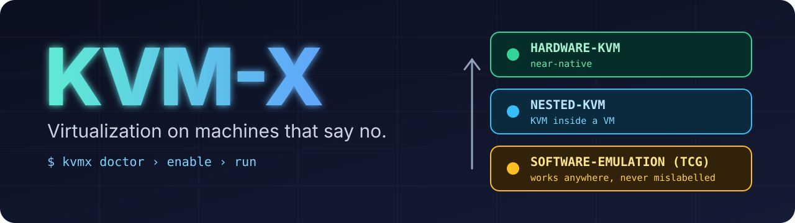
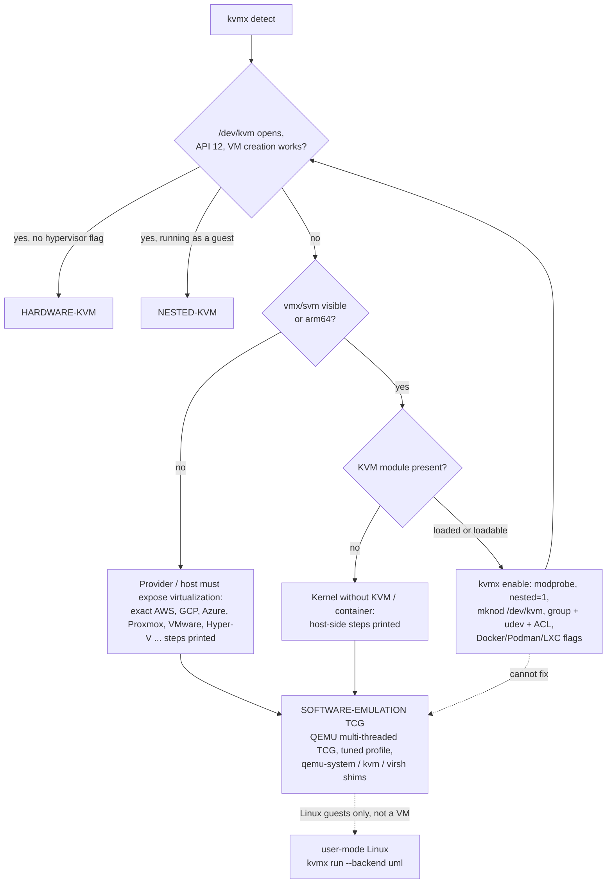

<p align="center">
  
</p>

<p align="center">
  <a href="https://github.com/KVM-X/KVM-X/actions/workflows/ci.yml"></a>
  <a href="https://github.com/KVM-X/KVM-X/releases/latest"></a>
  <a href="LICENSE"></a>
  
  
  
  
</p>

# KVM-X

**`kvmx` tells you the truth about virtualization on a Linux box, fixes what can be fixed, and gives you the best fallback when it cannot.**

Plenty of VPSes, containers and CI runners have no nested virtualization: there is no `vmx`/`svm` CPU flag, or `/dev/kvm` is missing or locked,
and `qemu -enable-kvm` dies. KVM-X walks a ladder from the best option down, applies the reversible fixes it is allowed to,
prints the exact provider-side steps it is not, and finishes by reporting one of exactly three statuses:

| Status | Meaning |
| --- | --- |
| `HARDWARE-KVM` | `/dev/kvm` works on bare metal. Near-native speed. |
| `NESTED-KVM` | `/dev/kvm` works inside a VM. A little slower, I/O notably so. |
| `SOFTWARE-EMULATION (TCG)` | No hardware virtualization. QEMU emulates the CPU. **Roughly an order of magnitude slower.** |

Software emulation is **never** reported as KVM, and `kvmx run --mode kvm` refuses to fall back silently.

```console
$ kvmx status
SOFTWARE-EMULATION (TCG) - CPU-bound guests typically ~10x slower than hardware KVM (5-30x by workload); measure with `kvmx bench`
$ kvmx run --demo        # boots a real Linux guest (Alpine) in the best available mode
```

## Install

```bash
curl -fsSL https://raw.githubusercontent.com/KVM-X/KVM-X/main/install.sh | bash
```

The installer prints what it will download and where it will install (`/usr/local/bin`, or `~/.local/bin` without root/sudo), verifies the
release's `SHA256SUMS`, and asks before using `sudo`. Or grab `kvmx-linux-amd64` / `kvmx-linux-arm64` from the
[latest release](https://github.com/KVM-X/KVM-X/releases/latest), or `go install github.com/KVM-X/KVM-X/cmd/kvmx@latest`, or use Docker (below).
The binary is static and has no runtime dependencies besides what you ask it to install (QEMU).

## Quick start

```bash
kvmx doctor          # what this machine can do, what is blocking more, what only your provider can change
kvmx enable          # prints the plan (every file and command), asks, applies, logs it, re-checks
kvmx run --demo      # boot the tiny test guest and print the mode and timing
kvmx revert          # undo everything kvmx changed
```

Every command takes `--json` and `--dry-run`. `kvmx enable --dry-run` changes nothing.

## How it works



1. **Detect** (`internal/detect`): `/proc/cpuinfo`, `systemd-detect-virt`, DMI vendor strings (AWS/GCP/Azure/Oracle/Hetzner/...), kernel modules and the
   `nested` parameter, and a real probe of `/dev/kvm` (open, `KVM_GET_API_VERSION == 12`, create a VM). Containers, capabilities, seccomp, read-only sysfs,
   sudo availability. Optional `--cloud-metadata` adds the instance type from the link-local metadata service (the only non-download network call, opt-in).
2. **Enable**: blockers become reversible steps (`modprobe`, `/etc/modprobe.d`, `mknod`, `kvm` group, udev rule, ACL, QEMU via apt/dnf/yum/zypper/pacman/apk,
   shims, systemd unit). Each change is shown first, journaled, and undoable. Things only the layer below can change are printed as exact commands.
3. **Fall back**: `kvmx run` builds a tuned QEMU TCG command line (multi-threaded TCG, virtio, serial console, 9p/virtiofs), `kvmx` itself stands in for
   `qemu-system-*`, `kvm` and `virsh` so existing scripts keep working, and for Linux guests user-mode Linux is available as a non-VM extra rung.

Design notes, the research behind each rung and what was rejected: [docs/DESIGN.md](docs/DESIGN.md).

## Supported platforms

"Verified" is stated precisely: **real** = exercised on a live system by the maintainers; **CI** = the end-to-end test (install QEMU with the distro's
package manager, boot a real guest under TCG, shim, revert) runs on GitHub Actions; **fixture** = detection logic is tested against a hand-built snapshot
of what that platform exposes (the fixtures are synthetic, built from provider documentation; send a real `kvmx collect` and we will replace them); **docs** = instructions
come from provider documentation and were not tried.

| Platform | Usual result | What kvmx does | Verified |
| --- | --- | --- | --- |
| Bare metal Intel/AMD | `HARDWARE-KVM` | loads module, `/dev/kvm` node, group/udev/ACL, `nested=1` | real (AMD Ryzen, Arch), fixture |
| Bare metal arm64 (EL2) | `HARDWARE-KVM` | same, no `nested` knob | fixture |
| KVM guest with nested enabled (Proxmox, libvirt, OpenStack, oVirt) | `NESTED-KVM` | module/node/permissions | fixture |
| KVM guest with generic CPU type (Proxmox `kvm64`/`qemu64`) | TCG | explains `qm set VMID --cpu host`, libvirt `host-passthrough` | fixture |
| AWS EC2 (virtual) | TCG, or `NESTED-KVM` on nested-capable Intel families once enabled | prints `describe-instance-types`/`--cpu-options NestedVirtualization=enabled` | fixture, docs |
| AWS `.metal` | `HARDWARE-KVM` | as bare metal | docs |
| Google Compute Engine | TCG, or `NESTED-KVM` on Intel/N4D created with nested virtualization | prints the `gcloud` flag, image license, org-policy hint | fixture, docs |
| Azure | TCG, or `NESTED-KVM` on nested-capable sizes (Dv3/Ev3 and newer) | loads module, prints size guidance | fixture, docs |
| Oracle Cloud VM | TCG | points to bare-metal shapes | fixture, docs |
| Hetzner, DigitalOcean, Vultr, Linode, OVH, Scaleway, Alibaba, ... | depends on plan | tells you whether vmx/svm is exposed; otherwise TCG | fixture |
| VMware, Hyper-V, VirtualBox guests | `NESTED-KVM` when the host exposes it | prints the host setting (`vhv.enable`, `Set-VMProcessor`, `--nested-hw-virt`) | docs |
| Xen PV/HVM guests | TCG | prints `nestedhvm=1` for HVM | fixture, docs |
| WSL2 | `NESTED-KVM` with `nestedVirtualization=true` | prints the `.wslconfig` setting | fixture, docs |
| Docker / Podman | `HARDWARE-KVM`/`NESTED-KVM` when `/dev/kvm` is passed, else TCG | `kvmx flags docker`; image and compose file included | CI (image build + TCG boot in the container); `enable`/`revert` and the UML backend also exercised in containers by hand |
| LXC / LXD, Kubernetes | as Docker | `kvmx flags lxc\|lxd\|k8s` | docs |
| OpenVZ / shared-kernel containers | TCG only | cannot load modules; says so | fixture |
| arm64 cloud VMs (no EL2) | TCG | explains why | fixture |
| apt (Debian, Ubuntu), dnf (Fedora, RHEL family), yum, zypper (openSUSE), pacman (Arch), apk (Alpine) | install QEMU, boot, shim, revert | per-distro package maps | CI matrix (7 images), unit tests |

## Usage

### Know where you stand

```console
$ kvmx detect
  STATUS     HARDWARE-KVM
             expected performance: near-native CPU and memory speed (a few percent overhead)
  ready:     yes - kvmx run can start a VM now

  cpu:       AMD Ryzen 5 3400G with Radeon Vega Graphics (x86_64, 8 logical) virt extension: svm
  virt:      bare metal
  kvm:       kvm_amd loaded, nested=Y
  /dev/kvm:  0666 kvm - API 12, VM creation OK
  qemu:      /usr/bin/qemu-system-x86_64 (11.1.3, tcg:true)
```

`kvmx status` prints one line and exits `0` (KVM), `10` (software emulation, ready) or `20` (nothing usable yet, for example QEMU is missing), so scripts can branch:

```bash
kvmx status -q; case $? in 0) echo kvm;; 10) echo slow;; 20) kvmx enable --yes;; esac
```

`kvmx doctor` is the checklist with fixes and, for the blockers only your provider can change, the exact commands:

```console
$ kvmx doctor
kvmx doctor - SOFTWARE-EMULATION (TCG)

  [FAIL] no vmx/svm CPU flag
         -> see manual steps below
  [ok  ] QEMU 8.2.2 at /usr/bin/qemu-system-x86_64 (tcg:true)

Things only the owner of the layer below can change:

  * Google Compute Engine: enable nested virtualization
      Supported only on Intel VMs (and N4D); not on E2, memory-optimized, or Arm VMs. Linux KVM only.
      $ gcloud compute instances create NAME --enable-nested-virtualization --min-cpu-platform="Intel Haswell" ...
```

### Fix what can be fixed

```console
$ kvmx enable --dry-run
Current status: SOFTWARE-EMULATION (TCG)
Reachable:      HARDWARE-KVM

[1/1] Let dev open /dev/kvm (group kvm, udev rule, ACL)  (kvm-access)
      $ sudo usermod -aG kvm dev
      write /etc/udev/rules.d/65-kvmx.rules (mode 0644)
            | # managed by kvmx
            | KERNEL=="kvm", GROUP="kvm", MODE="0660", OPTIONS+="static_node=kvm"
      $ sudo setfacl -m u:dev:rw /dev/kvm

Root is needed for the commands above; kvmx will run only those through sudo.
--dry-run: nothing was changed.
```

Run it without `--dry-run` to confirm and apply. Useful flags: `--no-qemu`, `--no-nested`, `--shims auto|yes|no`, `--persist` (systemd unit +
tmpfiles entry so the setup survives reboots), `--uml` (Debian: install user-mode Linux), `--arch aarch64`, `--yes`, `--json`.
Every applied change is appended to `~/.local/state/kvmx/journal.jsonl` (`/var/lib/kvmx` for a root login); `kvmx revert --list` shows them, `kvmx revert` undoes
them newest-first, `kvmx revert --remove-packages` also removes packages kvmx installed, `kvmx uninstall [--purge] [--self]` removes everything.

### Run a VM

```bash
kvmx run --demo                                    # tiny Alpine guest, prints mode + timing (~22 MB downloaded once, sha256-pinned)
kvmx run --disk debian.qcow2 --mem 4G --cpus 4 --hostfwd tcp::2222-:22
kvmx run --cdrom ubuntu.iso --disk new.img --display vnc=:0
kvmx run --kernel vmlinuz --initrd initrd.img --append "console=ttyS0 root=/dev/vda"
kvmx run --share ./project:src --share-mode 9p     # mount in the guest: mount -t 9p -o trans=virtio src /mnt
kvmx run --mode kvm ...                            # fail loudly instead of falling back to TCG
kvmx run --tcg-profile compat ...                  # fastest per vCPU, oldest ISA
kvmx run ... --dry-run                             # print the exact QEMU command line
```

The first stderr lines state the mode, for example `kvmx: mode SOFTWARE-EMULATION (TCG) - ...`; with `--json` the result carries the mode, command, timing and
guest benchmark values.

### Keep existing scripts working (shims)

With software emulation as the best option, `kvmx enable` symlinks `qemu-system-<arch>`, `kvm`, `virsh` and `virt-install` to the kvmx binary in `/usr/local/bin`.
If KVM works they run the real tool untouched; otherwise KVM-only options are rewritten:

```console
$ qemu-system-x86_64 -enable-kvm -cpu host -m 2G -drive file=vm.img,if=virtio -nographic
kvmx: KVM unavailable - running under SOFTWARE EMULATION (TCG), expect 5-30x slower CPU-bound performance
# runs: qemu-system-x86_64 -accel tcg,thread=multi,tb-size=256 -cpu max -m 2G -drive ...
$ virsh define vm.xml     # <domain type='kvm'> + host-passthrough  ->  type='qemu' + custom max CPU
```

`KVMX_VERBOSE=1` lists every rewrite, `KVMX_QUIET=1` hides the notice, `KVMX_FORCE_TCG=1` forces emulation (useful for testing). Table of rewrites: [docs/DESIGN.md](docs/DESIGN.md#compatibility-shims).
For libvirt: `kvmx libvirt xml` generates a TCG domain, `kvmx libvirt convert --domain NAME --apply` fixes an existing one.

### Containers

```bash
kvmx flags docker      # also: podman, lxc, lxd, k8s
docker run --rm --device /dev/kvm --group-add "$(stat -c %g /dev/kvm)" ghcr.io/kvm-x/kvm-x run --demo --yes
docker compose run --rm kvmx-tcg                          # works anywhere (software emulation)
docker compose --profile kvm run --rm kvmx-kvm            # when the host has /dev/kvm
```

### Benchmark your own host

```bash
kvmx bench --quick --include-kvm      # baseline, shipped profiles, KVM control: about a minute
kvmx bench --runs 5 --out my.json     # the full TCG matrix, interleaved runs, JSON for sharing
kvmx bench --include-uml --only uml   # user-mode Linux row (needs linux.uml)
```

## Performance, honestly

Measured with `kvmx bench` on a Ryzen 5 3400G, Alpine guest, 5 interleaved passes, medians ([full tables and method](docs/BENCHMARKS.md), raw JSON in [`docs/results/`](docs/results/)):

| | Boot to init | Shell loop | sha256 16 MB | 200k syscalls |
| --- | ---: | ---: | ---: | ---: |
| Hardware KVM | 1.4 s | 0.31 s | 0.11 s | 0.03 s |
| TCG `compat` (single-threaded, `qemu64`) | 4.7 s (3.5x) | 3.69 s (12x) | 0.68 s (6x) | 0.29 s (10x) |
| TCG `balanced` (default: multi-threaded, `max`) | 5.3 s (3.9x) | 4.63 s (15x) | 0.73 s (6.6x) | 0.27 s (9x) |
| user-mode Linux (Linux guests, not a VM) | 1.0 s | 0.37 s | 0.14 s | 3.65 s (122x) |

Four CPU-bound workers on 4 vCPUs: 8.35 s with single-threaded TCG vs 2.25 s with multi-threaded TCG (one worker alone takes ~2 s).

* **Order of magnitude, not percent.** CPU-bound guest work is 6-15x slower under TCG; boot is 3.5-4x slower.
* **Multi-threaded TCG matters for SMP guests** (3.7x on 4 vCPUs) and is on by default. Translation-cache size, machine type and kernel-command-line trimming made no measurable difference.
* **Avoid named Intel CPU models** with TCG: `-cpu Haswell` made guest syscalls 19x slower. kvmx uses `max` (default) or `qemu64` (`--tcg-profile compat`, faster, older ISA).
* **User-mode Linux** runs guest userland at native speed but pays ~120x on system calls. Great for compute-bound Linux work, wrong for I/O-heavy work.
* Differences under ~20% are within the noise of the (shared, desktop) host used.


## FAQ

**Is software emulation really that much slower?** Yes. QEMU's TCG translates guest instructions to host instructions in userspace. On the maintainers' host CPU-bound guest work took 6-15x longer under TCG than under KVM and an Alpine boot 3.5-4x longer. Expect worse for vector code or heavy I/O. No flag
changes that order of magnitude ([BENCHMARKS](docs/BENCHMARKS.md) shows which flags matter and which do not).

**Does kvmx get around my provider's restrictions?** No. It does not fake CPU flags or hide the hypervisor. If your provider does not expose VT-x/AMD-V, the only
real fixes are theirs (a different plan, a metal instance, a toggle), and `kvmx doctor` tells you which. TCG runs anywhere you may run QEMU.

**Why does it say `NESTED-KVM` on a cloud VM where I did nothing special?** `/dev/kvm` works there and the CPU shows the `hypervisor` flag, so you are a guest
of someone's hypervisor and it already allows nested virtualization.

**What does `nested=1` do and why does kvmx set it?** It controls whether *guests of this machine* see VT-x/AMD-V. It matters if this box hosts VMs (Proxmox, libvirt).
It does not affect this box's own `/dev/kvm`. Skip it with `--no-nested`.

**Can I run Windows or other operating systems?** Under TCG, in principle, slowly, and kvmx does not ship UEFI/OVMF integration or Windows tuning: pass your own
firmware via `-- extra qemu args`. The built-in test guest is Linux. User-mode Linux runs Linux userlands only.

**Why not emulate `/dev/kvm` so Firecracker and friends work?** See [DESIGN.md](docs/DESIGN.md#6-extra-rungs-investigated): the KVM ABI shares memory and vCPU state
with the VMM, so a faithful emulation is a project of its own (a software CPU behind a CUSE device). No maintained implementation exists; kvmx does not pretend otherwise.

**Does it work on macOS, Windows or the BSDs?** No. Linux only (amd64 and arm64 hosts). Use the platform's own hypervisor framework there.

**Does it send anything anywhere?** No telemetry. Network: the pinned test-guest download (shown and confirmed), release download in `install.sh`, your package manager
when you let `enable` install QEMU, and with `--cloud-metadata` one request to `169.254.169.254`.

**How do I undo everything?** `kvmx revert` (add `--remove-packages` for packages), or `kvmx uninstall --purge --self`.

## Troubleshooting

| Symptom | Fix |
| --- | --- |
| `permission denied` on `/dev/kvm` right after `enable` | Group membership applies at next login: `newgrp kvm`, or log out and in. The ACL step grants access immediately when `setfacl` exists. |
| Container: `/dev/kvm` missing or `operation not permitted` | The container needs the device from the host: `kvmx flags docker`. A device cgroup rule is not something the container can grant itself. |
| `docker compose` refuses to start with `/dev/kvm` | The device does not exist on the host. Use the default `kvmx-tcg` service, or load `kvm_intel`/`kvm_amd` on the host. |
| `no vmx/svm CPU flag` on a VPS | Your provider has not exposed it. `kvmx doctor` prints the provider-specific switch, or use software emulation. |
| `QEMU is not installed` | `kvmx enable` (uses apt/dnf/yum/zypper/pacman/apk). |
| Arch: `enable` fails with 404s | Your package database is stale; run `sudo pacman -Syu` once, then `kvmx enable`. kvmx only refreshes the database itself on a system that has none. |
| RHEL/Rocky: no `qemu-system-x86_64` | The package is `qemu-kvm` and the binary `/usr/libexec/qemu-kvm`; kvmx and its shims find it there. |
| TCG guest is slow or hangs at boot | Lower `--cpus`; try `--tcg-profile compat`; give it more `--mem`; run `kvmx bench --quick`. A kernel that needs x86-64-v2/v3 will not boot with `compat`. |
| UML: `/dev/shm must be not mounted noexec` | UML needs an executable tmpfs. Docker: `--tmpfs /tmp:exec`. kvmx picks one automatically when it exists. |
| Shim does nothing | `command -v qemu-system-x86_64` must resolve to `/usr/local/bin/...`; put that directory before `/usr/bin` in `PATH`. |
| "refusing to change the system without confirmation" | Not on a terminal: pass `--yes`. |

## Limitations

* **Software emulation is slow.** There is no trick that closes the gap, and KVM-X will not claim otherwise.
* Detection of "hardware vs nested" uses the `hypervisor` CPU flag and `systemd-detect-virt`; a host that hides both looks like bare metal. The `/dev/kvm` probe, not that heuristic, decides whether KVM is usable.
* Inside containers kvmx can only try to create `/dev/kvm`; the container runtime decides whether it is usable.
* Provider instructions come from public documentation and change; the linked docs win.
* aarch64: KVM needs the kernel to boot at EL2 (rare on cloud VMs). The aarch64 test guest and UEFI paths are less exercised than x86_64.
* user-mode Linux: Linux guests, x86_64 only, one vCPU, slow system calls, packaged on Debian 12/13 only, needs an executable tmpfs. It is not a VM and has its own status label.
* `virsh`/`virt-install` rewriting is text-based and targets the common KVM-only settings; exotic domains may need manual edits. Remote libvirt URIs are never rewritten.
* Linux only; amd64 and arm64 hosts.
* Fixtures for non-bare-metal platforms are synthetic; real `kvmx collect` reports are welcome.
* 9p and virtiofs shares: the QEMU arguments are unit-tested, but no CI test boots a guest that mounts them (the pinned test guest has no 9p modules).

## Security notes

* Runs as your user; individual commands are escalated with `sudo` only after the plan is printed and confirmed (`--yes` skips only the question, never the printing).
* `/dev/kvm` access uses group `kvm` (0660), a udev rule and a per-user ACL. Never 0666.
* Every system change is journaled; `kvmx revert` restores previous file contents and removes what kvmx created.
* Shims are plain symlinks to the kvmx binary; they exec the real tool. Nested virtualization increases a host's attack surface: leave `nested=N` (`--no-nested`) on machines that should not host hypervisors.
* No telemetry; downloads are hash-pinned (test guest) or checked against `SHA256SUMS` (installer). Details and reporting: [SECURITY.md](SECURITY.md).

## Development

```bash
make build test lint        # unit tests need no root, KVM or network
make integration            # real TCG boots, shims, Docker, distro matrix (needs qemu + docker)
python3 testdata/gen_fixtures.py   # regenerate detection fixtures
```

See [CONTRIBUTING.md](CONTRIBUTING.md) (platform reports and fixtures are the most valuable contribution) and the [Code of Conduct](CODE_OF_CONDUCT.md).

## License

[MIT](LICENSE)
