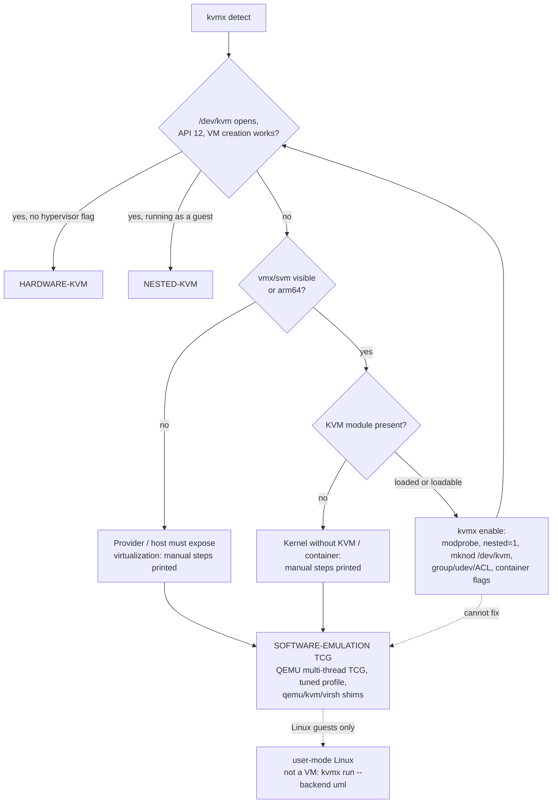

# KVM-X design and research notes

This document records what KVM-X does, why, and what it deliberately does not do.
Numbers quoted here come from `kvmx bench` runs stored in
[`docs/results/`](results/) and summarised in [BENCHMARKS.md](BENCHMARKS.md).

## 1. Problem

Many Linux machines people rent or are given (VPSes, containers, CI runners, Proxmox
guests) cannot run hardware-accelerated virtual machines: the provider does not expose
VT-x/AMD-V to the guest ("no nested virtualization"), or the box is a container that was
not given `/dev/kvm`, or the device exists but the user cannot open it. Users then lose
hours finding out which of these it is and what the next-best option is.

KVM-X answers three questions, in order, with evidence:

1. **What can this machine do right now?** (`detect`, `status`, `doctor`)
2. **Can that be improved, and what exactly would change?** (`enable`, with a printed plan)
3. **If not, what is the best software fallback, tuned and ready?** (`run`, `bench`, shims)

and always reports one of three statuses, never inflating a lower one:
`HARDWARE-KVM`, `NESTED-KVM` or `SOFTWARE-EMULATION (TCG)`.

## 2. The ladder

| Rung | Mechanism | Needs | What kvmx automates | Measured cost (this repo's guest) |
| --- | --- | --- | --- | --- |
| `HARDWARE-KVM` | `/dev/kvm` on bare metal | VT-x/AMD-V enabled, KVM module | module load, `/dev/kvm` node, permissions | baseline |
| `NESTED-KVM` | `/dev/kvm` inside a guest | hypervisor passes vmx/svm through | same, plus provider instructions | typically 5-30% CPU, worse I/O |
| `SOFTWARE-EMULATION (TCG)` | QEMU translates guest code in userspace | nothing but QEMU | install QEMU, profile, shims, libvirt rewriting | 6-15x slower CPU-bound, boot 3.5-4x; see BENCHMARKS |
| user-mode Linux (extra) | guest kernel is a host process | `linux.uml`, exec tmpfs, ptrace | install on Debian, rootfs, tmpfs choice | CPU ~native; syscalls ~13x slower than TCG |

## 3. Detection

`internal/detect` is a pure function of a `sys.System` (files, command output, device
nodes, uid). The real implementation is `sys.Host`; tests and bug reports use
`sys.Fixture` (a recorded directory, produced by `kvmx collect`). Facts gathered:

* **CPU**: `/proc/cpuinfo` (`vmx`/`svm`/`hypervisor`/`ept`/`npt`; model; arm64 `Features`).
* **Virtualization**: `systemd-detect-virt --vm/--container`, `virt-what`, `/.dockerenv`,
  `/run/.containerenv`, `/proc/vz`, `/proc/xen`, PID 1 cgroup, WSL kernel release.
* **Provider**: offline, from DMI (`sys_vendor`, `product_name`, `bios_vendor`,
  `chassis_asset_tag`): AWS, GCP, Azure, Oracle, Hetzner, DigitalOcean, Vultr, Linode, OVH,
  Scaleway, Alibaba, OpenStack, QEMU/Proxmox, VMware, VirtualBox, Hyper-V, Xen. Instance
  type only with `--cloud-metadata` (the single opt-in network probe, link-local only).
* **KVM**: `/sys/module/kvm*`, `nested` parameter, `modules.dep`/`modules.builtin` (is the module
  loadable?), kernel config, `/proc/misc` minor, and an actual **probe**: open `/dev/kvm`, check
  `KVM_GET_API_VERSION == 12`, create and close a VM. A node that exists but fails any step
  is *not* usable, and the reason (EACCES, ENODEV, ...) is reported.
* **Sandbox**: capabilities (`CAP_MKNOD`, `CAP_SYS_MODULE`, `CAP_SYS_ADMIN`), seccomp, read-only
  sysfs, `modules_disabled`, cgroup version, sudo.
* **Tools**: real (non-shim) QEMU and its `-accel help` (does this build have TCG?), qemu-img,
  virsh, virtiofsd, docker/podman, `linux.uml`, package manager, distro.

**Hardware vs nested.** The verdict is `NESTED-KVM` when `/dev/kvm` works *and* the
CPU shows the `hypervisor` flag or a VM type is detected; a container on a bare-metal
host is therefore `HARDWARE-KVM`, a container inside a cloud VM is `NESTED-KVM`. This is a
heuristic (a host can hide the flag); the probe, not the heuristic, decides *usable*.

**Blockers** have stable IDs (`cpu-no-virt-ext`, `kvm-kernel-missing`, `kvm-module-not-loaded`,
`dev-kvm-missing`, `container-no-kvm-device`, `dev-kvm-permission`, `container-kvm-denied`,
`kvm-unusable`, `qemu-missing`, `nested-param-off`). Each is marked `fixable` (a kvmx step
exists) or manual. `potential_mode` is the best status reachable if every fixable blocker is fixed.

### The nested parameter

`kvm_intel nested=1` / `kvm_amd nested=1` matters for the machine that **hosts** VMs: it decides
whether *its* guests see vmx/svm. It does not affect whether this machine can use `/dev/kvm`
itself. kvmx therefore treats `nested=N` as an advisory blocker (`nested-param-off`), and
sets it in `/etc/modprobe.d/kvmx.conf` (reloading the module only when its refcount is 0) so
a box that is a Proxmox/libvirt host gives its guests nested virtualization. Disable with `--no-nested`.

## 4. Enablement: plan, ops, journal

`internal/plan` turns blockers into **steps**; steps are lists of **ops** (`internal/ops`):
`WriteFile`, `Symlink`, `Mknod`, `Run`, `PkgInstall`. Each op

* describes itself exactly (what the user sees before confirming),
* is idempotent (writing identical content, an existing node, or an existing symlink is a no-op),
* returns an **undo** that is appended to `journal.jsonl` before the next op runs.

`kvmx revert` replays undos newest-first; package removal is opt-in (`--remove-packages`) and
limited to packages that were absent before. Privilege: kvmx runs as the user and wraps only
individual commands in `sudo` (file writes use `sudo install`), after the plan was printed and
confirmed. `--dry-run` prints the same plan and stops. Changes survive reboot only if you ask
(`--persist`: a systemd oneshot unit and a tmpfiles entry); module loading is persisted via
`/etc/modules-load.d`, and the group/udev rule is persistent by nature.

Steps (IDs are stable and appear in `--json`): `nested-modprobe-conf`, `reload-kvm-module`,
`load-kvm-module`, `mknod-dev-kvm`, `kvm-access`, `install-qemu`, `install-uml`, `install-shims`,
`systemd-persist`.

`/dev/kvm` access never uses mode 0666: the fix is group `kvm` + udev rule (0660) + a per-user ACL
for immediate effect.

Inside containers kvmx can only try: it creates the node if it has `CAP_MKNOD`, but the container's
device cgroup usually still denies it, so it prints exact `docker`/`podman`/`lxc`/`lxd`/Kubernetes
flags instead (`kvmx flags <runtime>`). Provider toggles (AWS, GCP, Azure, Proxmox, libvirt,
VMware, Hyper-V, VirtualBox, Xen, WSL2, BIOS) are printed by `doctor`/`enable` from `internal/guide`.

## 5. Software fallback

### QEMU TCG

`kvmx run` builds the command line itself (`internal/qemu`): `-machine q35 -accel
tcg,thread=multi,tb-size=N -cpu max`, virtio-blk/net/rng, serial console, `-no-reboot`, 9p or
virtiofs shares, optional VNC. `--mode kvm` refuses to fall back (it is for scripts that must
not silently run slowly); `--mode auto` picks KVM when it works; the chosen mode is printed
on every run and recorded in `--json`.

Tuning options evaluated by `kvmx bench` (guest: Alpine linux-virt, pinned by sha256):

| Factor | Finding (details in [BENCHMARKS.md](BENCHMARKS.md)) | Decision |
| --- | --- | --- |
| Multi-threaded TCG (`thread=multi`) | 4 parallel workers on 4 vCPUs: 8.35 s single-threaded vs 2.25 s multi-threaded (3.7x). No effect at 1 vCPU. | default on (`balanced`) |
| vCPU count | MTTCG scales with vCPUs only while the host has idle cores; boot work is mostly serial. | default 2, profile cap 4 |
| `-cpu max` vs `qemu64` | `max` boots ~15-25% slower and the sha256 row ~30-55% slower at equal vCPUs, but exposes the ISA modern distributions need (x86-64-v2/v3). | `max` by default; `compat` keeps `qemu64` |
| Named CPU models (`Haswell`, ...) | Guest syscalls 19x slower (the model hides hardware immunity so the guest enables Spectre/MDS mitigations). | never chosen automatically |
| `tb-size` | No measurable difference 32 MiB to 1 GiB on short workloads. | 256 MiB as headroom, not an optimum |
| Machine type | `pc`, `q35`, `microvm`: within noise. | `q35` |
| Kernel command line (`quiet`, `nokaslr`, ...) | Not faster. | not used by shipped profiles |

The honest summary: **no TCG flag changes the order of magnitude**. Software emulation costs roughly an
order of magnitude of CPU-bound speed; the only option with a large effect is multi-threading for SMP guests
(up to the vCPU count), and the largest *avoidable* mistake is a named Intel CPU model. Differences below ~20% are within this host's noise.

### Compatibility shims

`kvmx` is one static binary that also behaves as `qemu-system-*`, `kvm`/`qemu-kvm`, `virsh` and
`virt-install` when invoked through a symlink with that name (placed in `/usr/local/bin`, ahead of
`/usr/bin`). If `/dev/kvm` works the real tool runs untouched. Otherwise:

| Input | Becomes |
| --- | --- |
| `-enable-kvm` | dropped; `-accel tcg,thread=multi,tb-size=...` added |
| `-accel kvm`, `kvm:tcg`, `kvm,kernel-irqchip=on` | `-accel tcg,...` |
| `-machine ...,accel=kvm`, `kernel_irqchip=`, `kvm-shadow-mem=` | `accel=tcg`, KVM-only keys dropped |
| `-cpu host`, `host,migratable=off,+vmx` | `-cpu max` (named models keep the model, drop `kvm=`, `hv-*`, `+vmx/svm`) |
| `-global kvm-pit.*` | dropped |
| libvirt `type='kvm'`, host-passthrough CPU, `<hyperv>`, `<kvm>`, kvmclock/hypervclock timers, `ioapic driver='kvm'` | `type='qemu'`, custom `max` CPU, removed |
| `virt-install --virt-type kvm --cpu host` | `--virt-type qemu --cpu max` |

`virsh define|create FILE` is rewritten on the fly; `kvmx libvirt convert --domain NAME --apply`
fixes an already-defined domain; `kvmx libvirt xml` generates a TCG domain. Remote libvirt URIs
are never rewritten (the local `/dev/kvm` says nothing about the remote host).

## 6. Extra rungs investigated

| Candidate | Verdict | Why |
| --- | --- | --- |
| **User-mode Linux (UML)** | **Implemented** (`kvmx run --backend uml`, `kvmx enable --uml`, `bench --include-uml`) | Guest kernel is a host process: guest userland runs at native speed (shell loop 0.37 s vs 4.1 s TCG vs 0.31 s KVM) and boots in about a second. Costs: Linux guests only, x86_64 only, one vCPU, system calls pay a ptrace tax (200k syscalls took 3.65 s vs 0.28 s TCG and 0.03 s KVM), needs an exec-capable tmpfs (Docker: `--tmpfs /tmp:exec`), packaged only on Debian 12/13 (others build `ARCH=um`). **It is not a VM** and kvmx never labels it as one: it uses its own status, `USERSPACE-KERNEL (UML)`. |
| `/dev/kvm` emulated by a CUSE/FUSE daemon backed by a software CPU | Not implemented; no existing project found | The KVM ABI shares memory with the VMM (`kvm_run` page mmap'd per vCPU, guest RAM registered by userspace address). A CUSE daemon would have to reach into another process's memory and implement a full CPU, MMU and interrupt controller behind ioctls: re-implementing QEMU TCG as a KVM server. Possible as a research project, and the only way to run KVM-only VMMs (Firecracker, Cloud Hypervisor, crosvm, libkrun, Kata) without hardware, but not something to ship as a reliable tool today. |
| Firecracker / Cloud Hypervisor / crosvm / libkrun / Kata | Not viable without KVM | They require `/dev/kvm` (Cloud Hypervisor also supports MSHV). They are good *destinations* once the ladder reaches a KVM rung; kvmx detects them only as tools. Kata can run QEMU, which brings back TCG. |
| gVisor | Not a VM | Its platforms (systrap, ptrace) sandbox containers without KVM; useful for isolating workloads, not for running guest kernels or other operating systems. |
| QEMU `mshv`, `nitro`, `xen` accelerators | Detected, not driven | `/dev/mshv` is reported in `detect`. These need specific hosts (Hyper-V root partition, Nitro Enclaves, Xen dom0) that cannot be tested generally. |
| Bochs, Unicorn, v86 and friends | Not worth it | Interpreters/emulators with narrower device support than QEMU TCG and slower in practice. |
| `qemu-user` + binfmt | Out of scope | Runs foreign-architecture *binaries*, not machines. Complements TCG for cross-arch container images. |
| Provider-side nested virtualization | **The best real fix**; documented | AWS (some Intel instance families, enabled per instance), GCP (Intel and N4D, flag at creation), Azure (Dv3/Ev3 and newer), Proxmox/libvirt/VMware/Hyper-V/VirtualBox/Xen/WSL2 toggles, or any bare-metal plan. `kvmx doctor` prints the exact commands. |

## 7. Safety and privacy

* No telemetry. Network use: pinned test-guest downloads (URL and size shown, sha256 verified,
  confirmation required), release download in `install.sh`, the distro package manager when
  you let `enable` install QEMU, and `--cloud-metadata` (link-local address only, enforced in code).
* Everything that changes the system is shown first, journaled, reversible.
* `--fixture` makes `enable` dry-run unconditionally, so recorded fixtures can never change the real machine.

## 8. Non-goals

kvmx does not make TCG fast, does not emulate `/dev/kvm`, does not manage VM fleets (use libvirt,
Proxmox, ...), does not bypass provider restrictions or terms of service, and supports Linux only.
